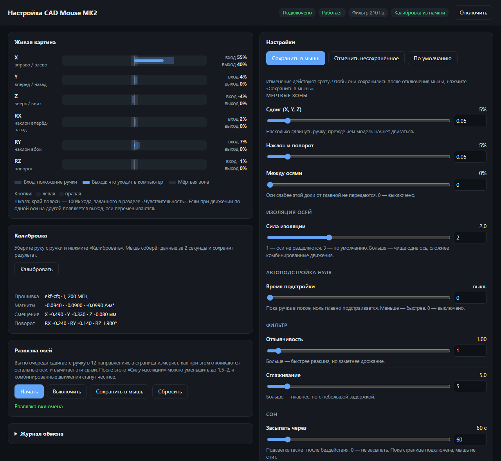

# CAD Mouse MK2 with web configurator

This repository builds on [sb-ocr/cad-mouse-mk2](https://github.com/sb-ocr/cad-mouse-mk2)
(hardware and original firmware) and the EKF firmware by
[maximweb](https://github.com/maximweb/cad-mouse-mk2) (branch `ekf-firmware`). It adds:

- **Web configurator** (`tools/configurator.html`): live view of all six axes,
  settings that apply immediately (deadzones, isolation, sensitivity per
  direction, filter, sleep), calibration, and saving to the mouse. It runs in
  Chrome or Edge over Web Serial, nothing to install.
- **Configurator on the mouse**: hold one button while plugging the mouse in and
  it also shows up as a read-only USB drive with the configurator page.
- **Guided axis decoupling**: a 12-step wizard measures how the axes leak into
  each other and removes it with a 6x6 matrix, so the isolation can be relaxed.
- **Nomad mode**: for Nomad Sculpt, whose 3D mouse support is unreliable, the
  knob drives Nomad's own mouse navigation (right drag rotates, middle drag pans,
  wheel zooms) and the buttons send undo and frame; toggled with a long press
  of the right button.
- **Fixes and tuning**: no lost button releases, faster wake from sleep, correct
  I2C clock after sleep on RP2040, calibrations stuck at their fit bounds are
  rejected, NaN guards kept under `-Ofast`, RP2040 overclocked to 200 MHz (filter
  ~4.7 ms instead of ~6.6 ms), optional auto zero and cross-axis deadzone.

The USB VID/PID are set to the 3Dconnexion SpaceMouse Compact (`256F:C635`), so
3DxWare picks the mouse up, and the reports use the same layout as that device
(translation in report 1, rotation in report 2, buttons in report 3), so software
that reads the device directly, such as Nomad Sculpt, also sees the rotation. See the [firmware documentation](./firmware/README.md)
for details.

## Web configurator

`tools/configurator.html` is a single page that talks to the mouse over USB with
Web Serial. Open it in Chrome or Edge and click "Подключить мышь" (the page is in
Russian). Nothing has to be installed, and it works offline.

- **Live view** of all six axes: the knob position before the deadzones and what
  is sent to the computer, plus the buttons. Axes leaking into each other are
  visible at a glance.
- **Settings that apply immediately**: translation and rotation deadzones,
  cross-axis deadzone, isolation strength, auto zero, sensitivity for each
  direction of every axis, filter responsiveness and smoothing, sleep timeout.
  "Сохранить в мышь" stores them in the mouse; saved settings override the
  firmware defaults.
- **Calibration** from the page, with the result and the calibrated magnet
  moments and offsets.
- **Axis decoupling wizard**: move the knob in 12 directions, the page measures
  how the other axes respond and removes that with a 6x6 matrix stored in the
  mouse. Afterwards the isolation can be relaxed for more natural combined
  movements.
- **Nomad mode**: assign each axis to rotate, pan or zoom, invert it, set the
  speeds, the Nomad mouse buttons and the shortcuts of the knob buttons.

**The page is also on the mouse.** Hold one button while plugging the mouse in
and it additionally shows up as a read-only USB drive `CADMOUSE` with
`configurator.html` (do not hold both buttons, that starts a calibration). Plug
it in again without a button to hide the drive.

The serial protocol and the firmware side are described in the
[firmware documentation](./firmware/README.md#configurator).

## Original project

Watch the build video ↓

This is the second iteration of my DIY CAD Mouse, rebuilt to behave like a real 6DoF controller. It uses a custom PCB with three magnetic sensors, a 3D printed spring, and a redesigned enclosure that is smaller and easier to build.

## Firmware

The firmware reads the three magnetic sensors, estimates the full
6DoF pose with a dipole physics model and extended Kalman filter, and uses both MCU
cores to separate sensor input from filtering. It supports persistent
calibration data and runs on both RP2040 and RP2350 boards.

See the [firmware documentation](./firmware/README.md) for implementation
details, tuning guidance, and LED status codes.

## Hardware

  Build instructions → [Instructables](https://www.instructables.com/CAD-Mouse-MK2-a-6DoF-Space-Mouse-Using-Magnets)

⚠️ There have been several comments raising concerns about the longevity of the PETG spring. If it does not last as expected, a revision of the knob design will be needed.

[![CC BY-NC-SA 4.0][cc-by-nc-sa-shield]][cc-by-nc-sa]

[![CC BY-NC-SA 4.0][cc-by-nc-sa-image]][cc-by-nc-sa]

[cc-by-nc-sa]: http://creativecommons.org/licenses/by-nc-sa/4.0/
[cc-by-nc-sa-image]: https://licensebuttons.net/l/by-nc-sa/4.0/88x31.png
[cc-by-nc-sa-shield]: https://img.shields.io/badge/License-CC%20BY--NC--SA%204.0-lightgrey.svg
